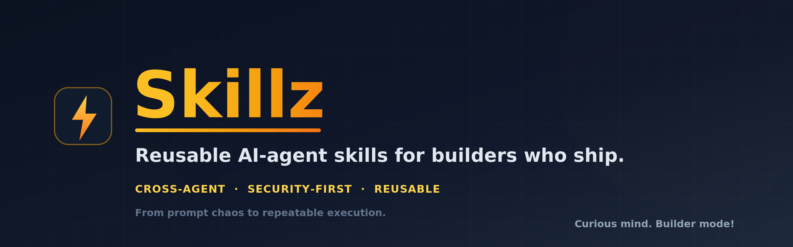

<div align="center">



<br/>

**Reusable AI-agent skills for builders who ship.**
_From prompt chaos to repeatable execution._

[](docs/SKILL_INDEX.md)
[](https://agentskills.io/specification)
[](#how-to-use-the-skills)
[](docs/PUBLICATION_CHECKLIST.md)
[](LICENSE)
[](https://github.com/tanveerriaz/Skillz/stargazers)

**Works with:** Claude Code · OpenAI Codex · Cursor · GitHub Copilot · VS Code · Antigravity

Created by **[Tanveer Riaz](https://github.com/tanveerriaz)** · Curious mind. Builder mode! 🇸🇬

</div>

---

Skillz is a public marketplace of practical [Agent Skills](https://agentskills.io/specification) designed to help AI coding agents move from prompt chaos to repeatable execution.

It is built around one idea:

> Good AI work should be reusable, reviewable, safe, and easy to transfer across projects.

This library focuses on practical execution skills for:

- AI-assisted coding
- SaaS building
- secure deployment
- debugging
- documentation
- product validation
- enterprise delivery
- founder operations

This is not a prompt dump. This is a reusable execution layer for AI-native builders.

## Why Skillz exists

AI agents are powerful, but without structure they produce scattered, one-off output. The same problems get re-solved differently in every project, and good patterns get lost. Skillz captures what works, standardizes it, and makes it reusable and safe across tools — so AI agents behave less like an unpredictable intern and more like a disciplined delivery partner.

## Who it is for

- **Solo builders and founders** who want repeatable systems instead of throwaway prototypes.
- **SaaS founders** shaping ideas into MVPs and shipping them safely.
- **AI engineers** building reliable LLM features with evals and guardrails.
- **Enterprise technology teams** that need banking-grade delivery discipline, generalized and public-safe.

## How it reflects a builder-first operating style

Every skill is written to be:

- **Builder-first** — practical steps, not theory.
- **Security-first** — secrets, private data, and destructive actions are guarded by default.
- **Reusable** — generalized so it works across projects and stacks.
- **Reviewable** — each skill has a quality checklist and safety rules.
- **Transferable** — one format, compatible across agentic tools.

Each skill helps an AI agent do one useful thing better, repeatedly, and safely.

## How to use the skills

Every skill lives in `skills/<skill-name>/SKILL.md` with optional `references/`, `scripts/`, `templates/`, and `examples/`. The frontmatter `description` tells an agent when to activate the skill; the body gives it the procedure, checklist, and safety rules.

### Claude Code
Install the whole library as a plugin marketplace:

```bash
/plugin marketplace add tanveerriaz/Skillz
/plugin install skillz@skillz
```

Or copy a single skill folder into your project's skills directory (e.g. `.claude/skills/<skill-name>/`). Either way, Claude reads each `SKILL.md` description and activates the skill when the task matches.

### Codex
Reference the relevant `SKILL.md` in your prompt or repo instructions. Paste or link the procedure as the working contract for the task.

### Cursor
Add a skill's guidance to `.cursor/rules/` as an `.mdc` rule, or keep the skills in-repo and reference the `SKILL.md` in your prompt. The procedure and safety rules map directly onto Cursor project rules.

### GitHub Copilot / VS Code
Add key skills to `.github/copilot-instructions.md` or your workspace instructions so Copilot Chat follows the same procedures. Keep the full skill in-repo for reference.

### Antigravity
Load the skill folders into your skills/instructions directory and reference them by name; the universal `SKILL.md` format is tool-agnostic.

> Tip: the `agent-memory-file` skill explains how to wire durable project context into any of these tools.

## Skill categories

| Category | Focus |
|----------|-------|
| `ai-agent-workflows` | Planning, executing, reviewing, and improving AI-agent work |
| `coding` | Generating, refactoring, and reviewing code |
| `debugging` | Systematic bug investigation and fix validation |
| `architecture` | Simple, scalable, maintainable system structure |
| `security` | Secure coding, secret scanning, data protection, safe config |
| `deployment` | Managed hosting, environment setup, release readiness, rollback |
| `documentation` | PRDs, changelogs, handoff notes, decision logs, doc hygiene |
| `product` | Idea validation, MVP scoping, user journeys |
| `banking-domain` | Generalized, public-safe enterprise delivery patterns |
| `devops` | Git workflows, release hygiene, repo readiness |
| `frontend` | Responsive, on-brand, accessible UI changes |
| `payments` | ISO 20022 / SWIFT message decoding, validation and mapping |
| `agent-safety` | Approval gates and stopping rules for agents that act on your behalf |
| `verification` | Builder/verifier separation and evidence-based ship gates |
| `backend` | APIs, validation, service patterns |
| `data` | Schema design, RLS, resilient batch processing |
| `founder-ops` | Turning experiments into reusable assets and systems |

See `docs/SKILL_INDEX.md` for the full grouped index with use cases.

## How to add a new skill

1. Create `skills/<skill-name>/SKILL.md` using the standard format (see `docs/SKILL_AUTHORING_GUIDE.md`).
2. Follow the naming rules: lowercase, hyphen-separated, action-oriented, max 64 chars, no leading/trailing hyphen.
3. Add `references/`, `scripts/`, `templates/`, or `examples/` only if they add real value.
4. Add a matching entry to `marketplace.json`.
5. List it in `docs/SKILL_INDEX.md` under its category.
6. Run the safety scan and validation (see `docs/VALIDATION_REPORT.md` and `docs/PUBLICATION_CHECKLIST.md`).

## How to validate skills

Run the bundled validator (also runs in CI on every push and PR):

```bash
python3 scripts/validate.py
```

It checks frontmatter, naming, duplicates, `marketplace.json` structure and path resolution, and runs a secret / private-data scan. Before publishing, also apply the `public-repo-safety-scan` skill.

> Note: there are two manifests by design — `marketplace.json` is the human- and agent-readable index, and `.claude-plugin/marketplace.json` makes the library installable via Claude Code's `/plugin marketplace add`.

## Public safety rules

This repository is public. Everything in it must be safe to share:

- No secrets, API keys, tokens, passwords, or `.env` values.
- No private URLs, internal IPs, or production system details.
- No personal, financial, or medical data.
- No employer/client names or confidential, proprietary content.

Where a useful pattern came from a private or sensitive project, it has been **generalized** into a public-safe version — never copied directly. When in doubt, content is excluded.

## Contribution guidelines

Contributions are welcome. Keep skills focused (one useful thing done well), practical (builder language, real steps), and public-safe (no private context). Match the existing format and tone, add the marketplace entry and index line, and run the safety scan before opening a pull request. See `docs/SKILL_AUTHORING_GUIDE.md` and `docs/BRAND_STYLE_GUIDE.md`.

## Philosophy

Skillz is built for people who use AI seriously, not casually.

The goal is simple:

- capture what works
- standardize it
- make it reusable
- keep it safe
- use it across tools
- improve it with every project

AI agents are powerful, but without structure they create scattered output.

Skillz gives them structure.

**From prompt chaos to repeatable execution.**

---

<div align="center">

### ⭐ Star history

[](https://star-history.com/#tanveerriaz/Skillz&Date)

<br/>


**Built by [Tanveer Riaz](https://github.com/tanveerriaz)**

Skillz — Reusable AI-agent skills for builders who ship.
Curious mind. Builder mode! 🇸🇬

</div>
