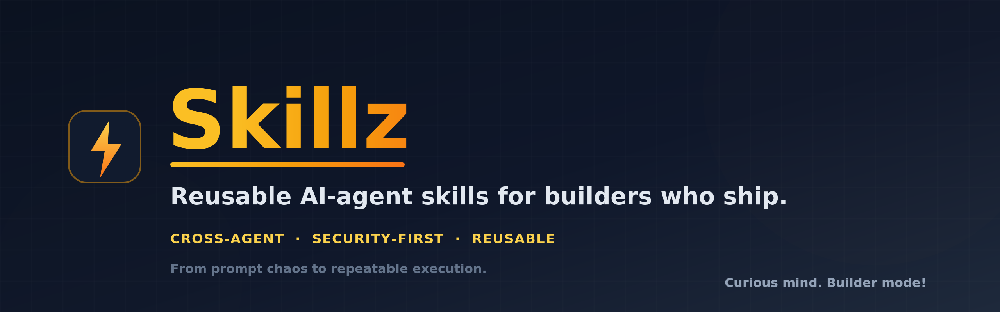
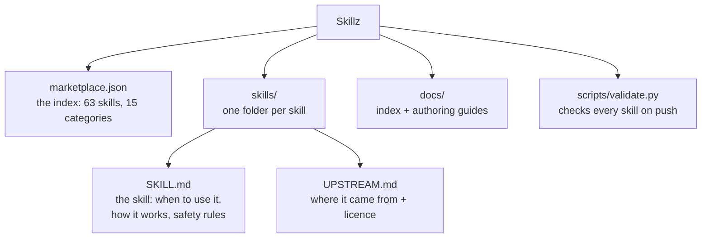
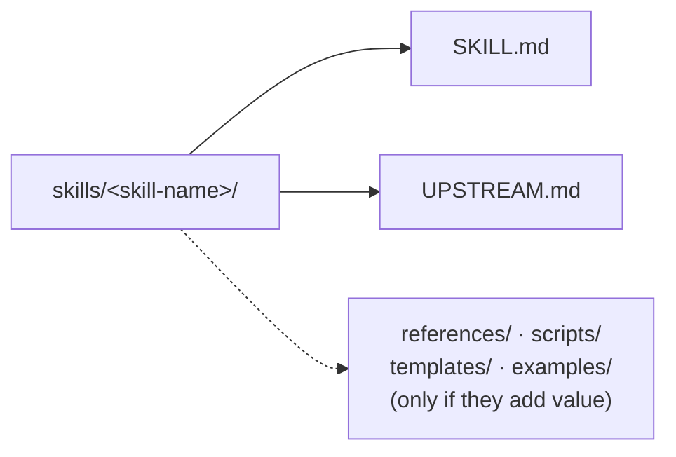

<div align="center">



<br/>

**Reusable AI-agent skills for builders who ship.**
_From prompt chaos to repeatable execution._

[](docs/SKILL_INDEX.md)
[](#find-a-skill)
[](marketplace.json)
[](docs/SKILL_INDEX.md)
[](https://agentskills.io/specification)
[](docs/PUBLICATION_CHECKLIST.md)
[](LICENSE)
[](https://github.com/tanveerriaz/Skillz/stargazers)

**Works with:** Claude Code · OpenAI Codex · Cursor · GitHub Copilot · VS Code · Antigravity

Created by **[Tanveer Riaz](https://github.com/tanveerriaz)** · Curious mind. Builder mode! 🇸🇬

</div>

---

Skillz is a public marketplace of practical [Agent Skills](https://agentskills.io/specification) that help AI coding agents move from prompt chaos to repeatable execution.

> Good AI work should be reusable, reviewable, safe, and easy to transfer across projects.

This is not a prompt dump. It is a reusable execution layer for AI-native builders.

## The repo in one picture



That is the whole structure. Everything else in the repo hangs off those four pieces.

**One skill = one folder:**



## Find a skill

Browse by category — each skill has a one-line description and a "use when" note in [the full index](docs/SKILL_INDEX.md).

| Category | Skills | What it covers |
|----------|-------:|----------------|
| `frontend` | 20 | Responsive, on-brand, accessible UI changes |
| `video` | 11 | Animated video production: motion graphics, launch films, promos, full pipelines |
| `ai-agent-workflows` | 7 | Planning, executing, reviewing, and improving AI-agent work |
| `documentation` | 4 | PRDs, changelogs, handoff notes, decision logs, doc hygiene |
| `product` | 4 | Idea validation, MVP scoping, user journeys |
| `data` | 3 | Schema design, RLS, resilient batch processing |
| `security` | 3 | Secure coding, secret scanning, data protection, safe config |
| `architecture` | 2 | Simple, scalable, maintainable system structure |
| `coding` | 2 | Generating, refactoring, and reviewing code |
| `devops` | 2 | Git workflows, release hygiene, repo readiness |
| `backend` | 1 | APIs, validation, service patterns |
| `banking-domain` | 1 | Generalized, public-safe enterprise delivery patterns |
| `debugging` | 1 | Systematic bug investigation and fix validation |
| `deployment` | 1 | Managed hosting, environment setup, release readiness, rollback |
| `founder-ops` | 1 | Turning experiments into reusable assets and systems |

🆕 **Newest: `video`** — 11 skills including [animate-video-flow](skills/animate-video-flow/SKILL.md) (brief → verified 9:16 video) and [motion-design-taste](skills/motion-design-taste/SKILL.md) (judging a cut). The HyperFrames skills ([creative](skills/hyperframes-creative/SKILL.md), [animation](skills/hyperframes-animation/SKILL.md), [core](skills/hyperframes-core/SKILL.md)) are Apache-2.0 text adaptations, pinned to `cea0bad7931122bd93680006978c0d9007daa3d4`.

## Use a skill in 3 steps

1. **Find it** in [the index](docs/SKILL_INDEX.md).
2. **Load it** — install the whole library, or copy one skill folder.
3. **Ask your agent** to use it by name. The skill's `description` tells the agent when to activate; the body gives it the procedure, checklist, and safety rules.

| Tool | How to load it |
|------|----------------|
| **Claude Code** | `/plugin marketplace add tanveerriaz/Skillz` then `/plugin install skillz@skillz` — or copy a skill folder into `.claude/skills/<skill-name>/` |
| **Codex** | Reference the relevant `SKILL.md` in your prompt or repo instructions |
| **Cursor** | Add the guidance to `.cursor/rules/` as an `.mdc` rule, or reference the `SKILL.md` in your prompt |
| **GitHub Copilot / VS Code** | Add key skills to `.github/copilot-instructions.md` or workspace instructions |
| **Antigravity** | Load the skill folders into your skills/instructions directory and reference them by name |

> Tip: the `agent-memory-file` skill explains how to wire durable project context into any of these tools.

## Add a skill in 6 steps

1. Create `skills/<skill-name>/SKILL.md` using the standard format (see `docs/SKILL_AUTHORING_GUIDE.md`). Lowercase, hyphen-separated, action-oriented, max 64 chars.
2. Add `references/`, `scripts/`, `templates/`, or `examples/` only if they add real value.
3. Add a matching entry to `marketplace.json`.
4. List it in `docs/SKILL_INDEX.md` under its category.
5. Run the safety scan and validation (below).
6. Open a pull request.

## Safety & validation

This repository is public. Everything in it must be safe to share: no secrets, API keys, tokens, passwords, or `.env` values; no private URLs, internal IPs, or production details; no personal, financial, or medical data; no employer/client names or confidential content. Where a useful pattern came from a private project, it has been **generalized** into a public-safe version — never copied directly. When in doubt, content is excluded.

Validate before opening a pull request — the bundled validator also runs in CI on every push and PR:

```bash
python3 scripts/validate.py
```

It checks frontmatter, naming, duplicates, `marketplace.json` structure and path resolution, and runs a secret / private-data scan. Before publishing, also apply the `public-repo-safety-scan` skill.

> Note: there are two manifests by design — `marketplace.json` is the human- and agent-readable index, and `.claude-plugin/marketplace.json` makes the library installable via Claude Code's `/plugin marketplace add`.

## Contribute

Contributions are welcome. Keep skills focused (one useful thing done well), practical (builder language, real steps), and public-safe (no private context). Match the existing format and tone, add the marketplace entry and index line, and run the safety scan before opening a pull request. See `docs/SKILL_AUTHORING_GUIDE.md` and `docs/BRAND_STYLE_GUIDE.md`.

## Philosophy

Skillz is built for people who use AI seriously, not casually. The goal is simple:

- capture what works
- standardize it
- make it reusable
- keep it safe
- use it across tools
- improve it with every project

AI agents are powerful, but without structure they create scattered output. Skillz gives them structure.

**From prompt chaos to repeatable execution.**

---

<div align="center">

### ⭐ Star history

[](https://star-history.com/#tanveerriaz/Skillz&Date)

<br/>


**Built by [Tanveer Riaz](https://github.com/tanveerriaz)**

Skillz — Reusable AI-agent skills for builders who ship.
Curious mind. Builder mode! 🇸🇬

</div>
